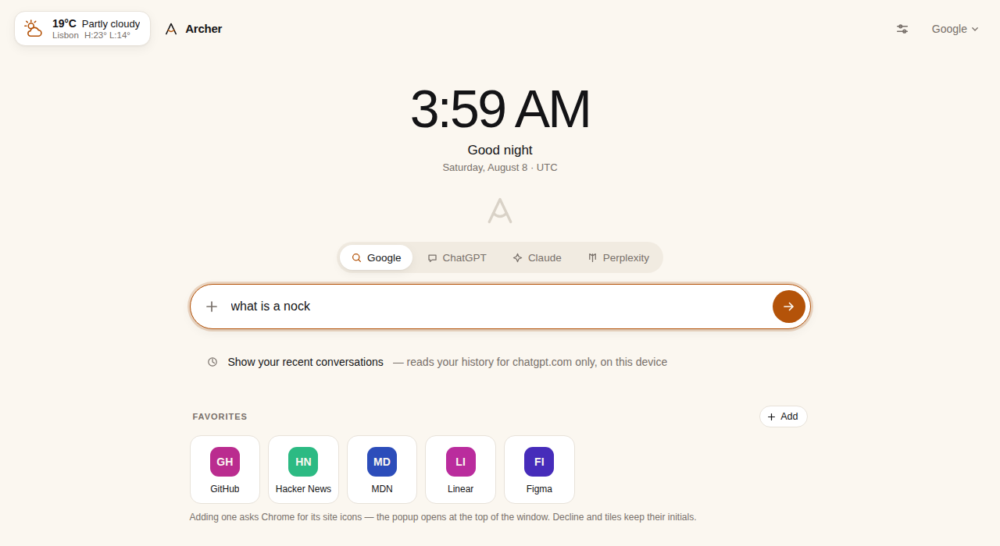

<p align="center">
  
</p>

<h1 align="center">Archer</h1>

<p align="center">
  <strong>AI on every new tab.</strong><br>
  One box in Chrome's new tab: ask a question or type a URL, and Archer works out which you meant.
</p>

<p align="center">
  <a href="https://chromewebstore.google.com/detail/archer-ai-new-tab/hagjdfgpkcfefgkpkelhfbeklkijeoah"><strong>➜ Add to Chrome</strong></a>
</p>

<p align="center">
  <a href="https://chromewebstore.google.com/detail/archer-ai-new-tab/hagjdfgpkcfefgkpkelhfbeklkijeoah"></a>
  <a href="https://chromewebstore.google.com/detail/archer-ai-new-tab/hagjdfgpkcfefgkpkelhfbeklkijeoah"></a>
  <a href="LICENSE"></a>
  <a href="https://github.com/thellis954/archer-tabs/actions/workflows/ci.yml"></a>
  <a href="extension/manifest.json"></a>
  <a href="https://github.com/thellis954/archer-tabs/stargazers"></a>
</p>

<p align="center">
  <a href="https://archertabs.app"><strong>Website</strong></a> ·
  <a href="#install">Install</a> ·
  <a href="#features">Features</a> ·
  <a href="#privacy">Privacy</a> ·
  <a href="docs/ROADMAP.md">Roadmap</a>
</p>

<p align="center">
  <picture>
    <source media="(prefers-color-scheme: dark)" srcset="web/assets/newtab-dark.png">
    
  </picture>
</p>

<!-- TODO(Tom): consider adding a short GIF of typing a question vs. a URL into the box. No GIF exists in the repo yet. -->

---

## Why Archer

ChatGPT Atlas had a good idea in its new tab: one box where you could ask a question or go to a
site without thinking about which was which. Atlas has since been discontinued. Archer brings that
kind of new tab to the Chrome you already use, without switching browsers and without signing up
for anything.

- **Bring your own AI.** Archer has no chatbot of its own. Send questions to ChatGPT, Claude,
  Perplexity, Google or your default search engine, or stream answers onto the page with your own
  OpenAI API key.
- **Nothing to sign up for.** No Archer account and no key required. Install it and it works.
- **It stays yours.** No ads, no tracking, no telemetry. Your prompts and settings live in your
  browser and nowhere else.
- **Free and open source** under GPL-3.0. Every claim on this page can be checked in the code.

> Archer is an independent project. It is not affiliated with or endorsed by OpenAI, Anthropic,
> Perplexity or Google; their names appear only as destinations you can choose.

## Features

**One box that keeps up with you**
- **Ask or navigate.** Type `claude.ai` and you land there; type `explain the offside rule` and it
  goes to your chosen AI. The decision uses the real list of top-level domains, the way the address
  bar does. Only `http(s)` addresses are ever opened.
- **Pick a destination** with one click on the pills above the box: Search, ChatGPT, Claude or
  Perplexity. The settings page adds Google, default search engine only, and answer on the page.
- **Override for one line:** <kbd>Cmd</kbd>/<kbd>Ctrl</kbd>+<kbd>Enter</kbd> always treats it as a
  question, <kbd>Shift</kbd>+<kbd>Enter</kbd> always treats it as an address.
- **Answers on the page** (optional): add your own OpenAI API key and replies stream onto the new
  tab. Pick the model, see token use, set a daily budget, and hit **Continue in ChatGPT** when it
  gets interesting.
- **Attach files** to a question: text and code files, `.docx`, `.xlsx`, `.pptx` and PDF text are
  read in the browser. Images go to vision models in on-page answers. A file it can't read still
  attaches, with a note saying why.

**Pick up where you left off**
- **Recent conversations** under the box, labelled with the question that started them (opt-in).
- **Prompt history** you can filter as you type, pin or dismiss.
- **Saved prompts:** name a prompt once, leave `{{blanks}}` in it, bring it back with <kbd>/</kbd>,
  and <kbd>Tab</kbd> between the blanks.
- **Export** everything you've asked as Markdown.
- **What you ask about:** a private tally of your own prompts (counts, top words, busiest hour),
  computed locally.

**A new tab that's yours**
- Clock, greeting and date.
- Weather card for a place you type in once (°C or °F). It never asks for your location.
- Favourites bar with coloured monogram tiles, or each site's real icon taken from Chrome's local
  cache. No request goes to the site.
- Top sites and recently closed tabs from the <kbd>+</kbd> menu (opt-in).
- Light and dark themes that follow your system.
- **Built for the keyboard:** <kbd>↑</kbd>/<kbd>↓</kbd> walk the rows, <kbd>Alt</kbd>+<kbd>↑</kbd>/<kbd>↓</kbd>
  switch destination, <kbd>Esc</kbd> backs out then clears, and you can start typing anywhere.

## Install

**[Add Archer to Chrome](https://chromewebstore.google.com/detail/archer-ai-new-tab/hagjdfgpkcfefgkpkelhfbeklkijeoah)** from the Chrome Web Store. One click, and Chrome keeps it up to
date. Open a new tab and you're done.

### Install from source

Prefer to run the code straight from this repo? Load it unpacked. It takes about five minutes, once.

1. **Download it.** On this page click the green **Code** button → **Download ZIP**, then unzip it
   somewhere you'll keep it (for example, your Documents folder).
   Prefer git? `git clone https://github.com/thellis954/archer-tabs.git`
2. **Open Chrome's extensions page.** Go to `chrome://extensions` and turn on **Developer mode**
   (top-right switch).
3. **Load it.** Click **Load unpacked** and choose the folder named **`extension`** inside the
   download, not the outer folder.
4. **Open a new tab.** That's it. Nothing to sign in to.

> **Updating:** Chrome doesn't auto-update extensions loaded this way. To update, download the
> latest ZIP (or `git pull`), replace the folder, and click **Reload** on Archer's card in
> `chrome://extensions`.
>
> **Note:** The first tab of a new browser session can briefly show Chrome's own new tab while the
> extension is still loading. That's expected behaviour.

⭐ **Star this repo** to follow new releases.

## Privacy

Archer has **no server**. There's no account, no analytics, no telemetry, no crash reporting and no
ads, so nothing you do in Archer reaches the people who make it.

- Everything Archer remembers (settings, prompt history, saved prompts, favourites, your API key)
  lives in `chrome.storage.local` on your device. It doesn't sync, and uninstalling deletes it.
- Archer has **no content scripts** and can't read the pages you visit.
- Data leaves your device only for features you use:
  - **Search:** your query goes to *your* default search engine through Chrome's own `chrome.search` API.
  - **ChatGPT / Claude / Perplexity / Google:** the tab navigates to that site with your prompt in
    the address, the same as typing it there.
  - **Answers on the page:** your prompt and key go straight from your browser to `api.openai.com`.
    Nothing goes through a proxy.
  - **Weather:** the place name you typed and its coordinates go to Open-Meteo.
- At install it asks for only `search` and `storage`. Everything else (history, top sites, closed
  tabs, clipboard, site icons, OpenAI, Open-Meteo) is **off until you turn it on**. Chrome asks at
  that moment, and you can switch each one off again in Archer's settings.

Full policy: [archertabs.app/privacy](https://archertabs.app/privacy) (source:
[`docs/PRIVACY.md`](docs/PRIVACY.md)).

## How it works

Archer is a Chrome **Manifest V3** extension that overrides the New Tab page. It has **no
dependencies and no build step**: the files in `extension/` are exactly what Chrome loads.

```
extension/        what you "Load unpacked": the shipped extension
  manifest.json   new tab override + settings page; permissions
  newtab.*        the new tab page (newtab.js only wires the DOM)
  options.*       the settings page
  src/            pure, unit-tested modules:
                  classify.js (URL or question?), router.js (where it goes),
                  conversations.js, library.js, answer.js (only OpenAI caller),
                  weather.js, clock.js, favorites.js, extract.js (attachments),
                  analytics.js, permissions.js, settings.js (only storage access) …
web/              the archertabs.app site (static, deployed on Vercel)
docs/             roadmap, brand, privacy policy, store listing
test/             unit tests (node --test) and a Playwright end-to-end suite
tools/            repo linter, screenshot, icon and store-asset generators
```

The decisions (is this a URL? where should it go? which rows to show?) are pure functions with no
DOM or network access, so they're covered by unit tests. Rows are rendered with `textContent` from a
`<template>`, and the linter fails the build on any `innerHTML`, because page titles are untrusted
text. The live demos on [archertabs.app](https://archertabs.app) run the same classifier and router
files as the extension, and the linter checks they stay identical.

## Build from source / develop

There's nothing to build. To run your working copy:

1. `chrome://extensions` → **Developer mode** → **Load unpacked** → select the `extension` folder.
2. Open a new tab. Edits to `newtab.*` show up on the next new tab; changes to `manifest.json` need
   **Reload** on the extension card.

| Command | What it does |
|---|---|
| `npm test` | Unit tests on Node's built-in runner. No install needed. |
| `npm run lint` | This repo's own invariants (CSP, no `innerHTML`, vendored files in sync, privacy page coverage…), not a style linter. |
| `npm run check` | `lint` + `test`, the same checks CI runs. |
| `npm run e2e` | Drives a real Chromium with the extension loaded. Needs Playwright. |
| `npm run shots` | Renders the new tab and settings page to `shots/` (also refreshes the site screenshots). |
| `npm run icons` / `og` / `store` / `siteshots` / `live` | Regenerate icons, the social card, store assets, site renders, or photograph a headed browser. |

Playwright-based commands need Playwright on the module path, e.g.:

```sh
mkdir -p node_modules && ln -s "$(npm root -g)/playwright" node_modules/playwright
```

Bump `version` in `extension/manifest.json` for any change meant to ship. See [`CLAUDE.md`](CLAUDE.md)
for the full engineering notes and the design decisions behind them.

## Roadmap

Phases 0–7 in [`docs/ROADMAP.md`](docs/ROADMAP.md) are done: correctness, the classifier, real
routing, history and recall, answers on the page, power features, the dashboard and store
readiness. Up next:

- **Chrome Web Store listing.** The copy and assets are ready in [`docs/STORE.md`](docs/STORE.md).
- Ideas parked in the roadmap: bang prefixes (`!g`, `!c`, `!p`), localisation, voice input.

## Contributing

Issues and pull requests are welcome.

- Found a bug or have an idea? [Open an issue](https://github.com/thellis954/archer-tabs/issues).
- Before a PR, run `npm run check`. For routing changes also run `npm run e2e`, and for UI changes
  look at `npm run shots`.
- Read [`docs/ROADMAP.md`](docs/ROADMAP.md) before substantive changes. It records the constraints
  (Web Store policy, trademarks, permissions) the design works within.
- New permissions should be optional and requested only by the feature that needs them, with a
  plain-language reason in `extension/src/permissions.js`.

## License

[GPL-3.0](LICENSE). Bundled Geist fonts on the website are under the SIL Open Font License
([`web/assets/fonts/OFL.txt`](web/assets/fonts/OFL.txt)).

---

<p align="center">
  If Archer makes your new tab more useful, <a href="https://github.com/thellis954/archer-tabs/stargazers"><strong>give it a ⭐</strong></a>. It helps other people find it.<br>
  <a href="https://archertabs.app">archertabs.app</a>
</p>
